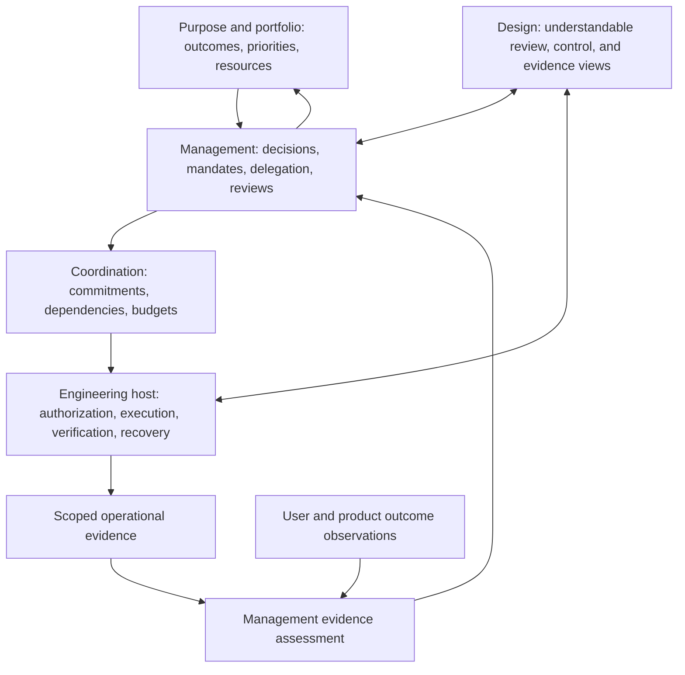

# Proposed reference architecture

Status: general architecture proposal with a narrower [local record and reservation pilot](PILOT.md). [Documentation index](README.md) · [Records](RECORDS-AND-LIFECYCLES-v0.1.md)

## Responsibilities and feedback

The divisions identify ownership and trust boundaries. A small product can implement them in one application. Product outcome observations and operational evidence have separate meanings even when presented together.

## Minimum implementation direction

Start with a durable management record store, an authenticated decision path, evidence references, and access-filtered review views. Integrate one engineering host through an adapter that preserves mandate and operation references. Keep effectful credentials in the enforcement path.

The management service records organizational decisions. The engineering host resolves and enforces current applicable authority for a specific action. A policy or delegation bridge needs explicit version, expiry, revocation, and unavailable-service behavior. A cached decision cannot silently outlive its authority.

## Boundaries to inspect

| Boundary | Incoming information | Owning responsibility |
|---|---|---|
| Person or client → management service | Recommendations, decisions, mandate edits | Authenticate identity, check decision rights, validate subject revision |
| Model or retrieved content → management service | Candidate plans and summaries | Treat as proposed data; check source and claim scope; prevent permission inheritance |
| Management → engineering host | Mandate and delegation references | Resolve current authority, enforce limits, reject unsupported revisions |
| Engineering → management assessment | Operation and verification references | Authenticate provenance, correlate scope, preserve unknown and partial effects |
| Product measurement → management assessment | Outcome observations | Preserve population, method, missing data, and attribution limits |
| Records → human or agent viewer | Summaries and evidence links | Enforce access at projection and source retrieval |

## Budgets and events

Reserve capacity before dispatch when needed to enforce shared ceilings. Count outstanding commitments and uncertain costs according to a documented conservative rule. Define what happens when cost observations are delayed or unavailable.

Events need stable identities and producer references so retries do not duplicate commitments or reviews. Preserve causality where it matters; a later timestamp does not necessarily override an earlier authoritative observation. A durable stop decision must lead to a separately observable runtime control result.

## First useful views

An initiative page shows its outcome, accountable owner, current mandate, resource state, evidence, and next review. A review page compares the criteria with observations and presents options and uncertainties. A delegation page shows current authority and its history. These are proposed views; the repository does not supply a dashboard.

## Implemented local boundary

The experimental host stores immutable record revisions in SQLite and keeps a separate current-mandate projection. `BEGIN IMMEDIATE` serializes record changes and budget reservations. A new mandate revision becomes proposed and prevents fresh reservations under the previous revision. Approval, pause, and revocation are recorded decisions; the local reservation path checks the current revision and validity interval.

Reservations consume a shared initiative ceiling and a cumulative mandate ceiling, including amounts reserved under earlier revisions of that mandate. They are neither actual spending records nor provider authorization. There is no settlement, release, or budget-increase API in this profile. Repeating an identical reservation request returns its historical record without creating capacity or fresh authority.

Review assessments use a frozen set of current, matching observations for a declared window. Explicit corrections link to retained predecessors. Restricted observations make derived reviews and linked decisions restricted. These are application checks around caller-selected fixture identities; direct database or Python-process access remains trusted. The pilot does not authenticate people, verify external provenance, or implement a network boundary.
